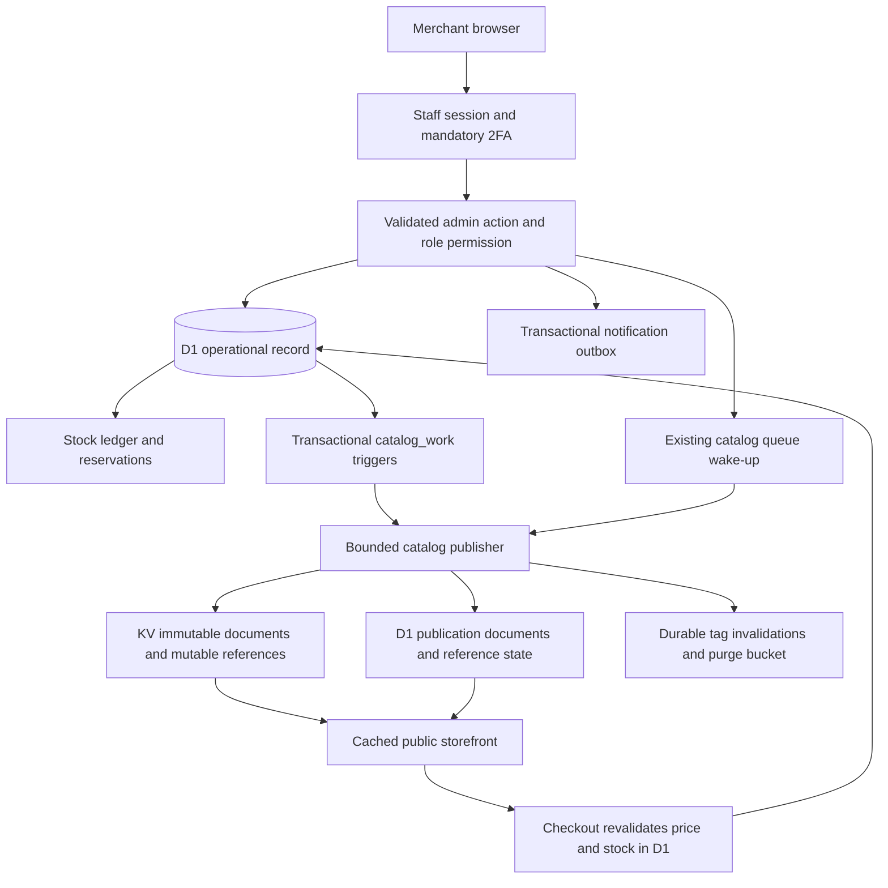

# Gate 0 architecture and correctness contracts

## Evidence boundary

Observed on checkout `f5689118c596d706aa7ce5ef956db9ba068de077`. Remote main is `6339f228c3dd7b9a71442d0983b73695bdab306e`, verified with `/usr/bin/git ls-remote origin refs/heads/main`. `git diff 6339f228 HEAD -- web/src/server/admin-actions.ts web/src/server/catalog-publisher.ts web/src/lib/permissions.ts web/migrations` is empty. Thirty referenced source and migration files were also compared byte-for-byte against the main archive at `/tmp/fully-flared-gate0-baseline`; all match. The archive has no `.git` metadata. `baseline-provenance.json` records each SHA-256 digest; parent audit owns archive acquisition provenance. References below therefore match both inspected checkout and archived main. This audit changes no application code and makes no deployed performance claims. Proposed contracts require behavioral proof during their feature PRs.

## Preserve the existing ownership

`adminActionFn` applies staff middleware, calls the domain dispatcher and compares the global work revision before and after a successful action to decide whether to wake the publisher (`web/src/lib/adminFns.ts:19–62`). Staff access requires enabled and session-passed 2FA (`web/src/server/session.ts:129–147`). Action permissions are enforced server-side, not merely hidden in navigation (`web/src/server/admin-actions.ts:300–345`). Preserve these boundaries.

## Map merchant actions to existing owners

| Merchant task | Existing action / permission | D1 ownership | Publication and operational side effects |
|---|---|---|---|
| Find products | `adminProducts`, staff-gated loader | Products list and count, currently 100-row offset | Read only; `admin-lists.ts:40–46` |
| Create product | `product.create` / product.create | Products, variants, stock, ledger | Product/variant triggers capture publication; action `admin-actions.ts:350–412` |
| Save product content | `product.update` / product.update | Product and slug redirect | Captured product work; current update is unconditional, `admin-actions.ts:834–875` |
| Edit variants | `variant.save`, `variant.bulkUpdate` / variant.save or bulk-update | Variants; bulk can also change stock | Product work for variant edits; stock is separate operational state, `admin-actions.ts:877–948,1042–1109` |
| Attach product image | `product.attachMedia` / product.attach-media | Product-media association | Product work captured by triggers, `admin-actions.ts:1348–1364`; migration 0004 lines 39–41 |
| Adjust physical count | `stock.adjust` / stock.adjust | Stock and append-only ledger | Immediate operation, inventory event; no catalog trigger on stock, `inventory.ts:322–343`, `admin-actions.ts:414–419` |
| Find and inspect orders | `adminOrders`, order.view | Orders, returns, refunds | Read only; separate return list currently loaded together, `admin-lists.ts:71–100` |
| Mark shipped | `order.ship` / order.ship | Conditional order transition | Atomic outbox insertion keyed `shipment-<orderId>`; retry cannot send a second keyed notification, but repeated action currently returns conflict rather than replay success, `admin-actions.ts:494–530` |
| Refund / approve return | `order.refund`, `return.refund`, `return.approve` | Refund and return domain helpers | Existing payment idempotency and stock reconciliation; keep out of content drafts, `admin-actions.ts:532–630` |
| Edit collection membership | `collection.setProducts`, `collection.toggleProduct` | Product-collection membership | Collection revision changes, not product revision, migration 0004 lines 48–50 |
| Save page / article | `page.save`, `post.save` | Sanitized content and media references | Editorial work captured; page sanitizer at `admin-actions.ts:789–832`, post action starts at 1376 |
| Export / erase customer account | `customer.export`, `customer.delete` | Account privacy helpers | Existing account ownership checks and transactional anonymization, `admin-actions.ts:1312–1346` |

The permission mapping above is authoritative in `web/src/lib/permissions.ts:123–161`. New batch actions must authorize each operation through the same resources. Stock restocking requires the extra stock permission in `admin-actions.ts:324–345`.

## Reuse revisions for atomic conflict detection

### Existing evidence

`catalog_work.target_revision` increments for products, variants and product-media associations (migration `0004_catalog_work_capture.sql:33–41`). Media has its own revision and fans out to products later. Collection membership advances the collection revision rather than the product revision (`:42–50`). The publisher itself can advance product revisions during media fanout (`catalog-publisher.ts:2926`). This means the counter is conservative, not a pure merchant content version. It can cause harmless extra conflicts.

The existing product action reads the slug and later updates by ID, without a revision condition (`admin-actions.ts:843–863`). Neither a browser timestamp nor a preflight read alone prevents lost updates.

### Proposed contract

Use existing per-entity `catalog_work` revisions, not a new revision service or global store-wide CAS. Product metadata, variants and attachment association edits use the product work revision. Media metadata edits use the media work revision and remain a separate command. Collection membership uses a collection-scoped command and its collection revision. Do not silently include shared media alt text or collection membership in a product-only token.

Editor load returns the relevant revision plus fields from one consistent D1 read snapshot. Missing revision is treated as zero only for an existing entity with no captured work, not as permission to recreate a deleted entity. Save supplies expected revision and changed fields. The first statement in the same D1 batch inserts into existing `batch_guard` if the entity is missing or its revision differs. All field, variant, media-association and redirect writes follow that guard in that transaction. Read the resulting revision inside the same batch and return it as the accepted revision. Do not chain several existing server actions and call that atomic.

A conflict returns 409 and leaves local edits intact. The UI offers reload-and-review; no automatic last-write-wins merge. A publisher-induced revision advance may prompt unnecessary review, an accepted v1 tradeoff to avoid adding a parallel counter. Gate 0 source review establishes feasibility only. Feature verification must prove two saves with the same expected revision cannot both commit and that child edits invalidate the expected token.

Product create has no existing entity revision. Its bounded create transaction must establish all required saleable fields atomically and return the captured revision. Price and variant drafts remain deferred until the pricing contract below passes.

## Make stock retry safety durable without a new service

### Existing evidence

`adjustStock` atomically updates stock and inserts a fresh UUID ledger row on every invocation (`inventory.ts:322–343`). The ledger primary key, SKU, delta, reason and reference fields already exist (`0000_initial.sql:322–330`), and update/delete guards make it append-only (`:660–663`). Atomicity is not replay protection. `variant.bulkUpdate` currently promises all-or-nothing updates, not per-item partial completion.

### Proposed minimal contract

Use the existing ledger as the successful-operation receipt. Each bounded adjustment request has a client-generated operation UUID. Derive a deterministic ledger ID from actor, operation UUID and SKU. Store a SHA-256 fingerprint of the canonical, schema-validated operation payload in existing `ref_id`, with `ref_type=admin-operation`. The fingerprint covers every accepted semantic field, including note or expected physical count if later added. It must not include transient transport metadata. The ledger ID excludes the payload fingerprint so reuse with changed payload conflicts rather than creating another receipt. Authenticate every replay. Inside one per-SKU D1 batch, reject a pre-existing ID with a different fingerprint or SKU/delta/reason, insert the ledger row only if absent, apply the stock delta only when that insertion occurred, and apply existing stock guards. A missing stock row or failed stock invariant aborts both writes. Record audit metadata in the same atomic unit using a deterministic audit ID derived from the operation/SKU and `INSERT ... ON CONFLICT DO NOTHING`. Existing `audit()` calls occur after stock commit, so simply retaining that call leaves an audit gap after a crash and can duplicate audits on replay. The feature must migrate this audit insertion into the batch rather than append another post-commit audit. A ledger receipt alone proves stock application, not that the current audit log is retry-safe. Stable receipt content must include any added note or set-count semantics before those fields are accepted; do not compare only the delta if request semantics differ.

For v1 use explicit delta adjustments with reason. Defer set-physical-count until its expected-count concurrency contract is approved. Return per-SKU `applied`, `already-applied`, `conflict` or `failed`. Retries resend only unresolved items with identical identifiers. A deterministic successful ledger receipt survives a lost response. Failed items leave no success receipt and can be retried. Current available count is read afresh and is not represented as the original response snapshot.

Use per-SKU atomicity for future inventory batches. The review UI explicitly states that some items can succeed while others fail. Keep the existing all-or-nothing variant bulk command intact until its caller is migrated; do not pretend its semantics are partial success. No new queue or cron is needed. Tests must prove same-key concurrency, lost-response replay, changed-payload rejection, mixed failure and ledger reconciliation.

## State publication guarantees honestly

| Merchant state | Durable evidence | Guarantee |
|---|---|---|
| Saved / accepted | Successful D1 transaction and returned entity revision | Authoritative content committed; public catalog may lag |
| Publishing | `processed_revision < acceptedRevision` or related work/build pending | Existing publisher/recovery owns completion |
| Publication delivered | Accepted source revision processed and required current references delivered | Writes to KV acknowledged, not global visibility |
| Propagating | Delivery complete but cache propagation cannot be observed everywhere | Storefront locations can still show earlier valid content |
| Needs attention | Existing work error/retry or delivery failure | Show retry/recovery status without deleting local changes |

The current publisher tracks `committed_seq`, `delivered_seq`, `pending_payload`, retry and failure (`catalog-publisher.ts:790–868`). A processed work row alone is insufficient evidence of KV delivery, because work completion and reference delivery are separate (`:3306–3332`). A valid cached listing reference is accepted without comparing it to latest D1 (`catalog-read.ts:142–156`). The 60-second public HTML TTL is the life of one HTML cache entry, not an end-to-end freshness bound (`public-cache.ts:139–144`).

Proposed v1 must not show a definitive global “Live” badge. Return accepted source revision from saves. Add an authenticated bounded read of existing work/reference/build state only if the current editor needs publication status. Use generic `catalog.rebuilt` as a refresh hint; reconnect, focus and editor-open reconcile through that read. No continuous polling and no new tracking table. Exact per-entity-to-delivery correlation is not already exposed by the action API. Until a feature test proves the existing records can establish it, show `Saved; publication pending` and a conservative store-publication status, not fabricated per-edit delivery certainty. Unrelated pending work can delay this conservative status and must be described as such.

Emergency unpublish is an immediate D1 change followed by existing publication and purge. Checkout blocks inactive content according to existing live validation; do not promise immediate removal from every cached page.

## Define price visibility before price drafts

Cart pricing reads live D1 variant prices (`cart.ts:150–155`) while public catalog publication is asynchronous. Therefore a D1 price update can precede the displayed storefront update. Preserve checkout price revalidation and existing commerce revision guards. V1 content draft excludes prices, tax, stock and operational availability. Existing price actions remain explicit immediate operations with a notice that storefront presentation can take time to update. Do not cache operational prices for checkout or weaken reservation validation to make the screens match.

A later price-draft PR needs an explicit shopper confirmation flow when current price differs from the displayed quote, tests across concurrent checkout and price edits, and an approved publication meaning. This audit does not claim atomic cross-KV/D1 price publication.

## Define guest identity and privacy before unified profiles

Existing customer lists enumerate user accounts (`admin-lists.ts:48–68`). Account erasure anonymizes orders by `user_id` (`account-deletion.ts:61–69`), not every guest purchase sharing an email.

Proposed merchant contact grouping is a display and search convenience only. Normalize email by trim and case-fold consistently for the contact view. Do not apply provider-specific dot or plus-address rewriting. Do not modify original transactional email values. The group key never authenticates a shopper, claims a guest order or moves order ownership. Shopper access continues to require authenticated order ownership or existing guest capability.

Show account-linked and guest order history as separately labeled records. Do not merge multiple authenticated accounts or attach notes to an email-only person automatically. V1 omits contact notes and tags until an explicit durable contact identity exists. Account deletion retains its current scope. Guest export/erasure is a separate owner-authorized workflow that previews exact order IDs, documents retained financial facts and scrubs personal data under the same transactional rules. Never silently enlarge an account deletion to unrelated people sharing an address. Separate staff management from customer views.

Required tests cover case variants, shared/reassigned emails, guest-only contact, mixed guest/account history, erasure previews, staff permission denial and a shopper attempting to obtain a guest order by changing their account email.

## Define rich content compatibility

Product descriptions are currently stored as submitted text (`admin-actions.ts:849–855`) and escaped in a paragraph on the public page (`routes/_shop.products/$slug.tsx:219–220`). Page content already passes the server sanitizer and media URL canonicalization (`admin-actions.ts:789–804`).

Proposed rich product descriptions use the existing sanitizer and media reference validation, not raw editor HTML. Preserve existing `description` as plain text for compatibility, SEO and FTS. Add a nullable dedicated sanitized HTML field only in the rich-description feature migration; existing records fall back to escaped text without rewriting their meaning. On rich saves, derive plain text from sanitized HTML server-side and write both atomically. Publisher product documents carry the optional HTML; public rendering uses sanitized HTML when present, escaped text otherwise. Add a versioned reader-compatible document schema change in that same PR. Existing plain descriptions containing angle brackets remain literal text. Sanitizer, links, media failures, FTS text and SSR rendering need behavioral tests.

## Comparison and decision

| Alternative | Outcome |
|---|---|
| New draft database, queue and autosave backend | Rejected for v1. The requested per-record review and publication does not demonstrate a need for more write paths. |
| Store-wide publication session | Rejected. It expands conflicts, partial failure and navigation complexity beyond the selected per-record island. |
| One atomic Save/Publish with browser memory | Recommended first. It already reduces repeated commits and work capture. |
| Same save plus IndexedDB | Add only if demonstrated recovery benefit outweighs identity, schema, eviction and cross-tab complexity. It does not independently reduce publication consumption. |
| New dedicated entity counter | Deferred. Existing catalog work revisions offer conservative CAS for correctly scoped entities. |
| New publication status service | Rejected absent evidence. Existing durable state can support a conservative status read; exact per-edit delivery is still an explicit verification gate. |

## Required acceptance evidence before affected PRs ship

- Same-revision concurrent saves yield one commit and one conflict; missing/deleted entity never recreates silently.
- Variant and association edits invalidate the product token; collection and shared media edits use their own token.
- Interrupted inventory response never doubles stock, changed payload cannot reuse an operation key, and every stock success has one matching ledger entry.
- An old but valid KV reference cannot cause a false “globally live” claim.
- Price update during checkout preserves current authoritative validation and requires appropriate shopper confirmation.
- Guest email matching never expands shopper authorization or account-erasure scope.
- Rich descriptions remain sanitized, searchable and backward compatible.

These are proposed acceptance criteria, not completed runtime tests in this architecture artifact.

## Disposable SQL proof

`python3 .audit/gate0/architecture/verify-contract-primitives.py` applies all archived main migrations unchanged to in-memory SQLite. Five cases pass in `contract-primitives-results.json`: stale same-base save rejection, variant token advance, same-key stock replay once, changed-payload rejection and stock-guard rollback of both receipt and delta. The stock proof inserts its uniqueness-gated ledger row before updating stock. This verifies SQL primitive feasibility only. It does not exercise D1 concurrency, the HTTP action, permission wiring or atomic audit insertion, which remain feature acceptance gates.
