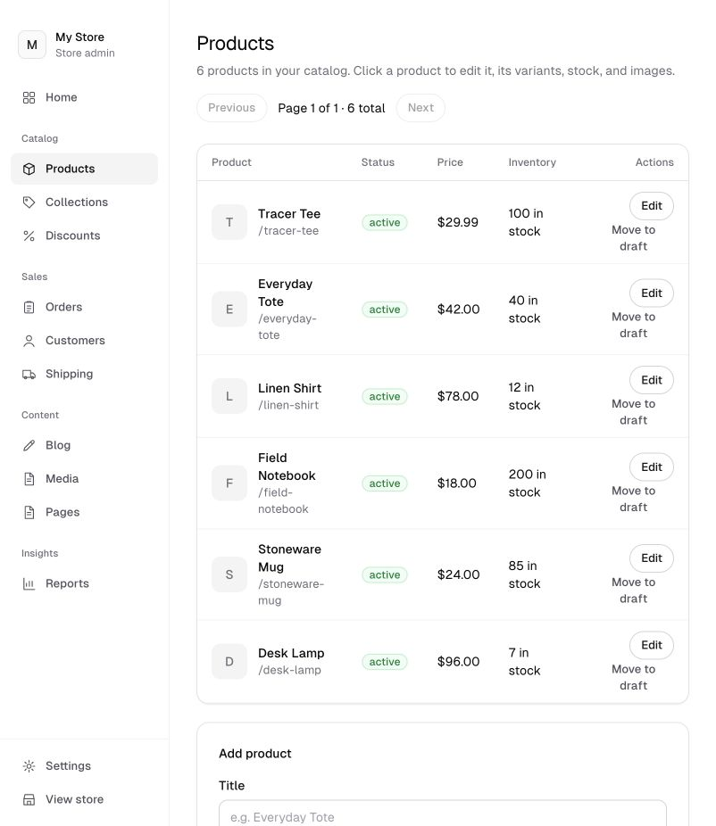
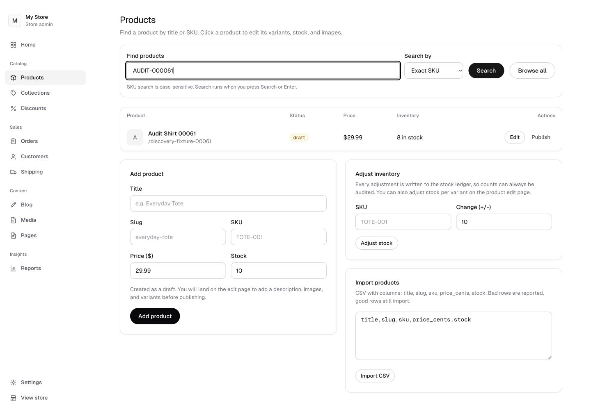
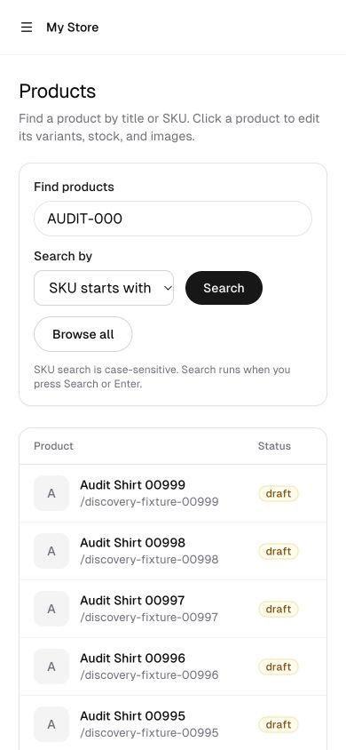

# Products discovery verification

This PR improves finding products. It preserves the merged admin shell and existing create, import, stock and editor actions. Status filters, editor redesign and persistent drafts remain later work.

## Behavior

Submit a title, exact SKU or SKU prefix. Typing and selecting a mode do not request data. SKU matching is case-sensitive. Title search requires all literal terms in the title, without exposing FTS operators. Results use newest creation date and ID ordering, 50 products per page. Search and cursor are stored in the URL. Both browser Back and the editor breadcrumb restore the filtered page.

Search discovery reads at most 1,001 candidates before deduplication, sorting and selected-page projection. More than 1,000 raw candidates produces the message "This search is too broad to display safely. Try a more specific title or SKU." The cap counts candidate rows before products are deduplicated. SKU candidates count variants, so one product with many matching variants can trigger this conservative limit even though only one product matches. The message never presents the raw candidate count as a product count. There is no exact total count or page-number jump. Cursor pagination is not a transactionally frozen snapshot while other staff edit products.

The existing full-count/offset admin query is removed. Public catalog queries and all commerce actions remain unchanged. No migration, index, dependency or infrastructure was added.

## Verification

- Discovery and admin safety tests pass, including searched Unicode cursor round trips, tied IDs, invalid/cross-query cursors, title-only matching, SKU casing, deduplication, a product with 1,000 variants and 50 media attachments, punctuation and malformed title input, a broad title search that refines and then succeeds when narrowed, an empty page returned for a cursor whose remaining rows were deleted, and malformed search parameters normalized to a safe search. The Products empty state for that deleted-cursor page offers a Back to first page action that keeps the committed search.
- Three real local workerd D1 probes passed at 10, 5,000 and 100,000 products. Regression ceilings apply to the controlled fixture's full browse calls and common-title discovery. They are not universal production budgets.
- Lint, type checking, migrations check, production build and the bundle boundary check passed. The bundle check runs against the fresh production build in the same session. Browser-safe search normalization lives in `web/src/lib/product-search.ts` with no imports. Zod validation stays in the server function boundary, so no Zod ships in the client bundle.
- Action feedback on the Products page uses the shared semantic success and error component from the merged admin shell, rendered below the page heading so table and form results stay visible. The list error state offers a Try again action.
- The compiled local preview passed exact SKU, prefix search, next/previous pages, editor return, browser Back, empty results, broad-search refinement and Enter submission. Typing and mode selection added zero local Worker GET/POST root requests before submission.
- Desktop, tablet, phone and 320px widths checked. The table scrolls inside a keyboard-focusable named region. At 320px, document width and scroll width both measured 320px.
- The remediation was rechecked over HTTP against the compiled local application with a disposable staff fixture. Browse, exact SKU, zero results, the new broad-search message and the signed-out redirect to sign-in returned the expected pages. Interactive keyboard, slow-network, injected-outage, permission-denial and screenshot checks were not rerun for the remediation in this environment. Loading and error components are present; existing staff and 2FA gates are unchanged and covered by the admin safety tests.

## Local resource evidence

[Recorded rows and query plans](resources.json) come from the runnable test below. The fixture has one active variant per product, no stock/media rows, a common title and an uncommon title.

| Logical operation at 100,000 products                | D1 rows read |
| ---------------------------------------------------- | -----------: |
| Previous first page, 100 cards plus count            |      799,999 |
| New first page, 50 cards including projection        |          399 |
| New page after 20 cursor pages, including projection |          402 |
| Exact SKU candidate hit / miss                       |        2 / 0 |
| Narrow / broad SKU prefix candidates                 |    3 / 2,002 |
| Narrow / common title candidates                     |    2 / 2,001 |

Counts cover list-function SQL, excluding staff/session/navigation queries and browser requests. This changes page size and query shape, so it is not a like-for-like latency comparison. The instrumented old Drizzle raw path performs an extra identical `all()` read to obtain D1 metadata, then executes the actual raw call. Reported counts represent each logical SQL statement once and exclude fixture setup and that instrumentation overhead. They are not total probe consumption.

Candidate limits bound application sorting and hydration, not all FTS internals. Price/stock/image projection still depends on child-row fanout. No deployed CPU, latency, checkout coexistence or monthly capacity claim is established. This read-only path adds no publication work by construction; KV, queues and purges were not measured as deployed zeros.

A bounded heavy page was added to the scale evidence. A full 50-product page where each product has 20 variants, 5 media attachments and stock for every variant read 4,047 D1 rows in 2 statements at the fixture size recorded by the test: 50 rows for the candidate query and 3,997 rows for the selected-page projection. Projection cost grows with child rows on the selected page and stays off the unselected catalog.

| Resource or claim                              | Classification | Evidence                                                                                    |
| ---------------------------------------------- | -------------- | ------------------------------------------------------------------------------------------- |
| D1 rows read for browse, search and projection | Measured       | Local workerd fixtures at 10, 5,000 and 100,000 products, plus the heavy page above         |
| Query count per discovery call                 | Measured       | Two statements for a ready browse or search page; one statement when a broad search refines |
| Worker CPU and deployed latency                | Unavailable    | No deployed measurement was taken for this change                                           |
| Checkout coexistence p95 gate                  | Unavailable    | No authorized isolated deployed run; not claimed as passed                                  |
| KV, queue and purge work from discovery        | Not applicable | The change is a read path and introduces no writes, by construction                         |
| Monthly cost at the planning workload          | Projected      | Depends on the unavailable deployed CPU and latency figures; no new figure is claimed here  |

Reproduce from the repository root with Node 24:

```sh
DISCOVERY_100K=1 npm test -- tests/admin-product-discovery-scale.test.ts
npm test -- tests/admin-product-discovery.test.ts tests/admin-safety.test.ts
npm run lint
npm run typecheck
npm run build
cd web && npm run check:bundle
```

## Screenshots

All data shown is disposable local fixture data.

Before:



After:




